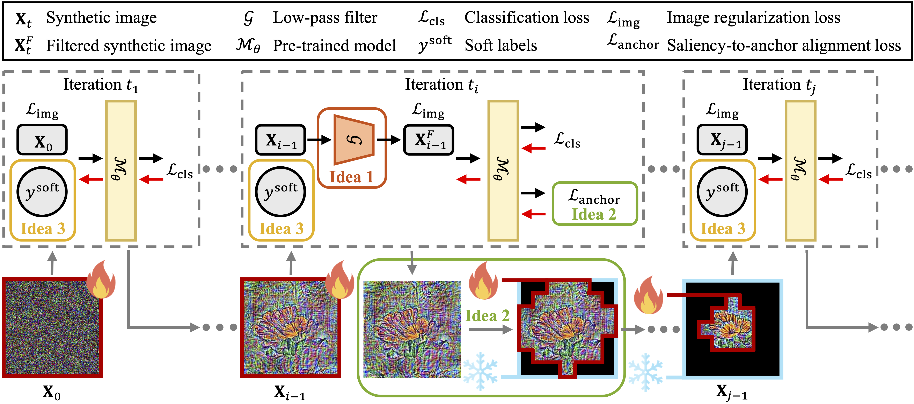

# Paint

This project is a Python implementation of **"Paint: Accurate, Efficient, and Sparse Model Inversion via Peripheral Sparsification and Anchor Alignment"**.
The paper proposes Paint, an accurate, efficient, and sparse model inversion framework for generating high-fidelity synthetic data.




## Prerequisites

Our implementation is based on PyTorch and timm libraries.

- Python 3.10.6
- PyTorch 2.1.0
- timm

We provide a `requirements.txt` file that contains all dependencies used in our experiments.
We checked the dependency using a workstation with Intel Xeon Gold 6534 and NVIDIA L40S, where its CUDA and cuDNN version was 12.1 and 8.9.5, respectively.

Install the required packages with the following code:

```shell
pip install torch==2.1.0 torchvision==0.16.0 torchaudio==2.1.0
pip install -r requirements.txt
```

### Usage
The main experiment can be excuted using the script:

```shell
bash scripts/w4a8_quantization.sh {gpu_id}
```

Example:
```bash
bash scripts/w4a8_quantization.sh 0
```

Before running the script, you should modify the dataset and datapool paths inside scripts:
```
--dataset <path_to_imagenet_dataset>
--datapool <path_to_save_synthesized_images>
```

### Code Description

This repository is written based on the codes from **Sparse Model Inversion (SMI)** (CVPR '24).

### Citation

Please cite the following paper:
```
@article{ChoiKK26,
    title = {Paint: Accurate, efficient, and sparse Model Inversion via peripheral sparsification and anchor alignment},
    author = {Choi, Jaehyeon and Kim, Minjun and Kang, U},
    journal = {PLOS ONE},
    volume = {21},
    pages = {1-19},
    number = {11},
    year = {2026},
    publisher = {Public Library of Science},
}
```